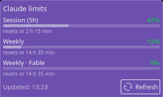

# Claude Usage — KDE Plasma widget

A KDE Plasma panel widget that always shows how much of your **Claude subscription limits** you have used: the 5-hour session window, the weekly limit and per-model weekly limits. You get a desktop notification before you hit them.




> **Unofficial project.** This project is not affiliated with or endorsed by Anthropic. It reads the same **undocumented** usage endpoint that Claude Code's `/usage` command uses. Anthropic can change that endpoint at any time. If it changes, the widget shows "Unexpected API response" instead of crashing.

## Features

- **Compact panel view:** `S 42% · W 12%` (session · weekly). The colour follows the highest limit: green below 70 %, yellow from 70 %, red from 90 %.
- **Popup:** a progress bar for every limit, the time until reset ("resets in 2 h 15 min"), the last update time and a *Refresh* button.
- **Desktop notifications** at 80 % and 95 %. You get one notification per limit window, so it does not repeat on every poll.
- **Read-only credentials:** the widget reuses the login of [Claude Code](https://docs.claude.com/en/docs/claude-code) and never modifies it.
- **Resilient:**
  - When offline or when the token has expired, the last known values stay on screen, greyed out, with an explanation.
  - A broken cache or state file is ignored.
- **Configurable:** refresh interval (2–60 min, default 5) and both notification thresholds.

## Requirements

- KDE Plasma **5** (tested on 5.24) or **6** (tested on 6.3). The installer picks the right variant.
- Python **3.10+**. Only the standard library is used.
- `notify-send`, from the `libnotify-bin` package on Debian/Ubuntu.
- [Claude Code](https://docs.claude.com/en/docs/claude-code), logged in with a Claude subscription. Tested with Max. `~/.claude/.credentials.json` must exist.

## Installation

```bash
git clone https://github.com/Madzik890/claude-usage-plasmoid.git
cd claude-usage-plasmoid
bash install.sh
```

Then right-click the panel → **Add Widgets…** → search for **Claude Usage** → drag it onto the panel.

`install.sh` does two things:
- copies the helper to `~/.local/bin/claude-usage`;
- installs or upgrades the plasmoid `com.github.madzik890.claudeusage` with `kpackagetool5` or `kpackagetool6`.

The Plasma version is detected from `plasmashell --version`. To choose it yourself, run `bash install.sh --plasma 5` or `bash install.sh --plasma 6`.

You can preview the widget in a window without touching your panel:

```bash
plasmawindowed com.github.madzik890.claudeusage
```

### Updating

```bash
git pull
bash install.sh
plasmashell --replace &   # reloads a widget that is already on the panel
```

### Uninstalling

```bash
kpackagetool6 --type Plasma/Applet --remove com.github.madzik890.claudeusage   # kpackagetool5 on Plasma 5
rm ~/.local/bin/claude-usage
rm -r ~/.cache/claude-usage-widget
```

## Configuration

Right-click the widget → **Configure Claude Usage…**

| Setting | Default | Range |
|---|---|---|
| Refresh interval | 5 min | 2–60 min |
| Warning notification | 80 % | 1–100 % |
| Critical notification | 95 % | 1–100 % |

## How it works

```
┌──────────────── Plasma panel ─────────────────┐
│  QML plasmoid (renders only)                  │
│    every N min runs ↓   parses JSON ↑         │
└──────────────────────┼────────────────────────┘
                       ▼
         ~/.local/bin/claude-usage  (Python helper)
           ├─ reads   ~/.claude/.credentials.json   (read-only)
           ├─ GET     https://api.anthropic.com/api/oauth/usage
           ├─ caches  ~/.cache/claude-usage-widget/last.json
           ├─ tracks  ~/.cache/claude-usage-widget/state.json (sent alerts)
           └─ calls   notify-send when a threshold is crossed
```

The helper always prints exactly one JSON object and exits with code 0:

```console
$ claude-usage --no-notify
{"status": "ok", "reason": null, "fetched_at": "2026-09-25T11:11:59Z", "limits": [
  {"id": "session", "label": "Session (5h)", "percent": 42, "resets_at": "2026-09-25T13:40:00Z"},
  {"id": "weekly", "label": "Weekly", "percent": 12, "resets_at": "2026-09-26T02:00:00Z"},
  {"id": "weekly:Fable", "label": "Weekly · Fable", "percent": 0, "resets_at": "2026-09-26T02:00:00Z"}]}
```

`status` takes one of three values:
- `ok`: fresh data.
- `stale`: the request failed and the cached data is returned.
- `error`: the request failed and there is no cache.

When it is not `ok`, `reason` says why: `no_credentials`, `token_expired`, `http_<code>`, `network`, `parse` or `internal`.

Options: `--warn N`, `--crit N` (notification thresholds in %) and `--no-notify`.

### Privacy

- The OAuth access token is only ever sent to `api.anthropic.com`. It is not logged, cached or printed.
- The cache contains only percentages and reset times. Its files are created with `0600` permissions.
- The widget never refreshes the token and never writes to `~/.claude/`. Claude Code refreshes the token itself whenever you use it.

## Troubleshooting

| Message | Meaning / fix |
|---|---|
| *Token expired — run Claude Code to refresh it* | The access token is short-lived. Start `claude` once and the widget recovers on the next refresh. |
| *Not logged in — run claude and sign in* | `~/.claude/.credentials.json` is missing or unreadable. |
| *Token rejected — run Claude Code* | The API returned HTTP 401. |
| *Cannot reach the API* | Network problem. The last known values are kept, greyed out. |
| *Helper unavailable — run install.sh* | `~/.local/bin/claude-usage` is missing, or it printed invalid output. |
| *Unexpected API response* | The endpoint changed or returned an error. Run `claude-usage --no-notify` to see the raw result. |

## Development

```bash
python3 -m pytest tests -q        # helper tests (no network)
TZ=UTC node tests/js/test_logic.js # presentation logic used by the QML
qmllint plasmoid/plasma6/contents/ui/*.qml
```

```
helper/claude_usage.py        helper CLI (fetch, normalise, cache, alerts)
plasmoid/                     KDE package com.github.madzik890.claudeusage
  common/                     files shared by both Plasma versions
    contents/ui/logic.js      formatting / parsing (unit-tested with node)
    contents/config/main.xml  configuration schema
  plasma5/, plasma6/          version-specific files: metadata.json,
    contents/ui/main.qml      runs the helper, holds state
    contents/ui/*Representation.qml, configGeneral.qml, config/config.qml
tests/                        pytest suite + JS tests
docs/superpowers/             design spec and implementation plan
install.sh                    per-user installer (merges common/ + plasmaN/)
```

## License

[MIT](LICENSE)
